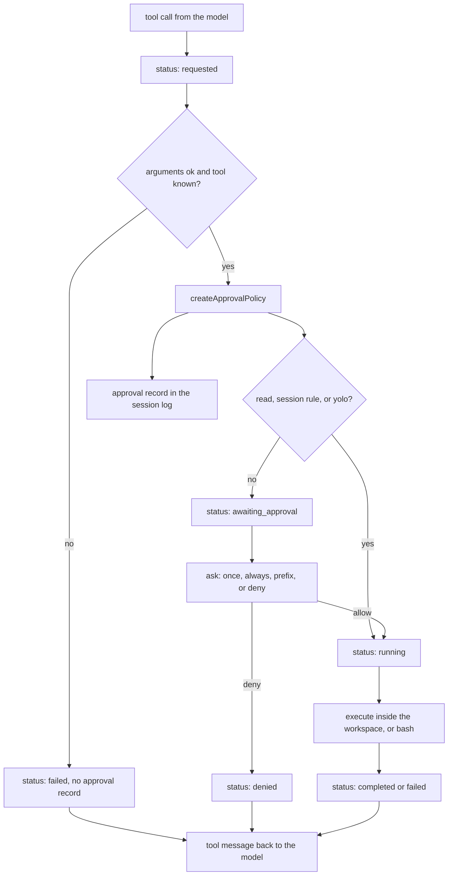

# Phase 2: Tools and guardrails

Phase 1 ran one tool, `bash`, and approved every call. This phase adds the file tools a coding agent actually uses, refuses paths that leave the working folder, and asks before a write or a shell command.

Read [phase 1](01-minimal-loop.md) first. The loop, the providers, and the session file are the same. This lesson is the new gate in front of `execute`.

## Learning goals

After this lesson you should be able to:

- Name the five tools and say which ones ask for approval.
- Explain why `../` and a symlink out of the folder are the same kind of refusal, and why `bash` is not part of that check.
- Trace one write from `requested` through the prompt to a tool result, including a denial the model can read.
- Find the matching `approval` record in the session log.

## Concepts

### A registry, not a switch

A tool is still a schema plus `execute`. Phase 2 adds two fields the loop can read without running the tool: `access` and `kind`.

| Tool | `access` | `kind` | Asks? |
|---|---|---|---|
| `read_file` | `read` | `read` | no |
| `glob` | `read` | `search` | no |
| `write_file` | `write` | `edit` | yes |
| `edit_file` | `write` | `edit` | yes |
| `bash` | `execute` | `execute` | yes |

`access` is the approval class. `kind` is a label on the status event, close to the Agent Client Protocol's tool-call kinds. The harness does not depend on ACP. The strings are just the vocabulary a later client will already know.

`ToolRegistry` is a map from name to tool. `register` throws on a duplicate name. `createAgentTools` in the CLI is the place that fills the registry. The loop still receives a plain array. It does not know how the app built it.

### The workspace boundary

File tools resolve every path with `resolveInWorkspace` before they open it. The working directory is realpath'd. The user path is resolved against that root. A lexical `../` that leaves the root is `path_escape`. Then each component is `lstat`'d. A symlink is realpath'd, and if the target is outside the root the call is refused, even when the link itself sits inside the folder. A missing final component is allowed, so `write_file` can create a new file, but only if the path that remains is still inside the root.

`bash` does not call this function. Its schema says so, and the system prompt says so. A shell can `cat /etc/passwd` or write a file anywhere the user can. Sandboxing that process is phase 6. `--yolo` does not turn the file boundary off.

### Structured errors stay inside the loop

Every failure is a `ToolResult`: `{ output, isError: true, code }`. `toolError` formats the text the model sees as `Error (${code}): ${message}`. Executors return that object. `executeTool` also catches a throw and returns `io_error`. `runLoop` never sees an exception from a tool.

The codes you will meet: `invalid_arguments`, `unknown_tool`, `path_escape`, `not_found`, `is_a_directory`, `edit_no_match`, `edit_ambiguous`, `timeout`, `command_failed`, `denied`, `io_error`.

`edit_file` counts exact, non-overlapping matches of `old_string`. Zero matches is `edit_no_match`. More than one is `edit_ambiguous`. In both cases the file is unchanged. An empty `old_string`, or `old_string === new_string`, is `invalid_arguments` and does not touch the file either.

### The approval policy

`createApprovalPolicy({ ask, yolo })` returns an `Approver` with memory for this run only.

Order inside one call:

1. `--yolo` allows immediately and records `source: "yolo"`. `ask` is not called.
2. `access: "read"` allows and records `source: "auto_read"`.
3. A tool name remembered from "allow always" allows and records `source: "session_rule"`.
4. A bash command whose first token matches a remembered prefix allows the same way. The match is the token itself, or the token plus a space or tab. `printf` does not match `printfx`.
5. Otherwise the policy calls `onAwaitingApproval`, then `ask`.

The prompt returns one of four choices: allow once, allow this tool for the rest of the session, allow this bash prefix for the rest of the session, or deny with a reason. A throw from `ask` becomes a denial. The policy does not throw.

`allowAll` is still exported. Tests that are about the tool, not the gate, pass it. The CLI does not.

The loop's default, when a caller forgets `approve`, is a policy whose `ask` always denies with "no approver configured". Reads still run. Writes and bash do not. That is safer than the phase 1 default, which allowed everything.

### Status events

The phase 1 events are unchanged: `assistant_text`, `tool_call`, `tool_result`, `turn_end`, `stop`. Each tool call also emits `tool_call_update` events. The fields are `id`, `name`, `title`, `kind`, `status`, and `rawInput` or `rawOutput` when this step has them.

| Status | When |
|---|---|
| `requested` | The model asked. Emitted before approval. |
| `awaiting_approval` | The policy is about to call `ask`. Skipped for reads, session rules, and `--yolo`. |
| `running` | The call was allowed and `execute` is starting. |
| `completed` | `execute` returned `isError: false`. |
| `failed` | `execute` returned an error, the arguments were invalid, or the tool name is unknown. |
| `denied` | The approver said no. `running` is not emitted. |

`completed` and `failed` use the ACP status names. `requested` lines up with ACP `pending`, and `running` with `in_progress`. ACP models the permission step as its own request. Here that step is `awaiting_approval`, and a rejection is `denied`.

An unknown tool and malformed arguments emit `requested` and then `failed`. They do not write an `approval` record, because nothing was asked.

A denial's tool message is `Error (denied): tool call denied. ${reason}`. The next model call sees it and can try something else, the same way it sees a bad exit code.

## Diagram



## Walkthrough

Read these in order. Skip a file once you can say which function a caller hits.

1. `src/core/tools.ts`
2. `src/core/workspace.ts`
3. `src/core/registry.ts`
4. `src/core/read-file.ts`
5. `src/core/write-file.ts`
6. `src/core/edit-file.ts`
7. `src/core/glob.ts`
8. `src/core/bash.ts`
9. `src/core/approval.ts`
10. `src/core/events.ts`
11. `src/core/loop.ts` (`runToolCall`)
12. `src/core/session.ts`
13. `src/cli/approve.ts`
14. `src/cli/agent.ts`
15. `src/cli/main.ts`, then `args.ts`, `config.ts`, and `print.ts`

### The tool type

`src/core/tools.ts` defines `ToolAccess`, `ToolKind`, `ToolErrorCode`, and `ToolResult`. `toolOk` and `toolError` are the two constructors executors use. `executeTool` looks the tool up by `schema.name`, awaits `execute`, and catches throws as `io_error`.

### Resolving a path

`resolveInWorkspace` in `src/core/workspace.ts` returns either `{ ok: true, path }` or a `ToolResult`. `isWorkspaceResult` tells those apart by the `isError` field. `escapes` is the predicate: the relative path from the root is `..`, starts with `../`, or is absolute.

Walk one example. Root `/work`. User path `notes/../secret.txt` resolves lexically to `/work/secret.txt` and is allowed. User path `../secret.txt` resolves to `/secret.txt` and is `path_escape` before any syscall past the root realpath. User path `link/file`, where `link` points at `/tmp/outside`, is `path_escape` after `realpath` on the link.

### The file tools

`readFile` in `src/core/read-file.ts` checks the path, refuses a directory, refuses a NUL byte, and refuses a file over 1_000_000 bytes unless you pass `start_line` / `end_line` (and still refuses past eight times that). Lines are 1-based and inclusive. Output is `N|text`, padded so the line numbers line up. Past `maxOutputChars` the head is kept and a truncation note is appended. That truncation is a success (`isError: false`), same as a truncated bash command.

`writeFile` creates parent directories, refuses an existing directory, and overwrites a file. `editFile` is the exact-match replace described above. `countOccurrences` is the non-overlapping count. `glob` matches `*` and `?` inside one segment and `**` across segments. It skips symlinks, so it neither lists them nor follows a symlink directory. A pattern containing `..` or NUL is `path_escape`. Results stop at 200 matches.

### Bash, still unsandboxed

`bashTool` now has `access: "execute"` and `kind: "execute"`. `runBash` is unchanged: `bash -lc`, cwd set, timeout, truncation, non-zero exit as `command_failed`. The schema description tells the model the command is not confined to the working directory.

### The policy

`createApprovalPolicy` in `src/core/approval.ts` closes over `alwaysTools` and `prefixes`. `bashCommandPrefix` is the first whitespace-separated token. `commandMatchesPrefix` is the match used on later calls. `ApprovalPrompt` is the callback the CLI implements. The policy calls `onAwaitingApproval` immediately before `ask`, which is how the loop emits `awaiting_approval` only when a person is actually about to be asked.

### Events and the loop

`ToolCallStatus` and the `tool_call_update` variant live in `src/core/events.ts`. The comment there is the ACP mapping. Do not add an ACP package to satisfy it.

In `runLoop`, each call emits `tool_call`, then `requested` with `rawInput`. `runToolCall` asks the approver, appends the approval record, and either emits `denied` or `running` plus `completed` or `failed`. The caller then appends the tool message and emits `tool_result`. So a normal allowed call looks like: `tool_call`, `requested`, `running`, `completed`, `tool_result`. A prompted call inserts `awaiting_approval` after `requested`.

The default approver is built at the top of `runLoop` when `options.approve` is omitted.

### The session record

`SessionLog.create` writes `version: 2`. `appendApproval` writes an `approval` record: `toolCallId`, `name`, `decision`, `source`, `createdAt`, and when they apply `scope`, `prefix`, `reason`, `path`, and `command`. `readSession` accepts version 1 and version 2. `RECORD_TYPES` includes `approval`. `appendChildSession` is still unused by the loop.

### The CLI prompt

`askApproval` in `src/cli/approve.ts` writes the prompt and reads lines from stdin. `y` is once, `a` is this tool for the session, `p` is the bash prefix (only offered for bash), `n` asks for a reason. EOF with no answer is a denial, "approval input closed". The line reader queues chunks so a two-line deny (`n`, then the reason) is not lost when the stream ends.

`main` builds `createApprovalPolicy({ yolo: config.yolo, ask: io.ask ?? askOnStdin })`. `--yolo` prints two warnings on stderr: every call is auto-approved, and bash is still not sandboxed. `printEvent` renders a status update as `tool_status <name> <id> <status>`.

## Run it

```sh
pnpm typecheck
pnpm test
```

The fake demo still runs `printf`. It will wait for an answer unless you pass `--yolo`:

```sh
pnpm harness --provider fake --yolo "say hello"
```

To see the prompt, omit `--yolo` and type `y`:

```sh
pnpm harness --provider fake "say hello"
```

```
Approval needed: bash
  printf 'hello from harness\n'
  y  allow once
  a  allow bash for the rest of this session
  p  allow commands starting with "printf" for the rest of this session
  n  deny
>
```

`a` remembers `bash` for the rest of that process. `p` remembers the prefix `printf`. `n` asks `Reason:`. The denial is a tool result, and the fake script's next step still answers, so the process exits 0.

With a real key, the model picks the tools. Answer each write and each bash call, or pass `--yolo` and read the warning.

```sh
export OPENROUTER_API_KEY=sk-or-...
pnpm harness "add a one-line note to NOTES.md"
```

## Exercises

Do these in a scratch branch, or revert them. `pnpm test` should pass when you are done, except where an exercise tells you to add a test.

### 1. Escape the folder

In a temp directory, point a symlink at a file outside it and call `readFile` on that path. You should get `path_escape` and `isError: true`. Then call `runBash` with `cat` on the same absolute path, passing `allowAll` if you go through the loop. The shell succeeds. Write down the function `bash` never calls.

`test/workspace.test.ts` already covers the symlink. Read it before you write a second copy.

### 2. Make `edit_file` fail on purpose

Create a file with the line `name = "a"` twice. Call `editFile` with `old_string` set to that line. The result code is `edit_ambiguous` and the file bytes are unchanged. Repeat with a string that does not occur and confirm `edit_no_match`. `test/edit-file.test.ts` is the same check.

### 3. Deny, and watch the model see it

Add a test, or extend the one in `test/approval.test.ts`, that denies `write_file` with reason `no notes`. Assert the next `FakeProvider` request contains a tool message matching `/denied/` and `/no notes/`, and that the file was not created. Also assert the status list contains `denied` and does not contain `running` for that call id.

### 4. Read the approval records

Run `pnpm harness --provider fake "say hello"`, answer `p`, and open the session file.

- Header `version` is 2.
- Find the `approval` record for `call_demo`. `decision` is `allow_always`, `source` is `prompt`, `scope` is `bash_prefix`, `prefix` is `printf`.
- Run it again with `--yolo`. The same call's `source` is `yolo`, and there is no `awaiting_approval` event.

### 5. A tool the policy does not know

Register a new tool whose `access` is `write` but whose `kind` is `other`. Call it through `runLoop` with `createApprovalPolicy` and an `ask` that returns `allow_once`. Confirm you were prompted, and that the status event's `kind` is `other`. Then set `access` to `read` and confirm `ask` is not called. The policy keys off `access`, not `kind`.

## What's next

Phase 3 streams tokens, keeps the event stream as the boundary for a TUI, and adds a local server. The status events from this phase are what that server will forward.

Phase 6 sandboxes `bash`. Until then the file boundary and the approval prompt are the guardrails, and a remembered bash prefix is only as tight as the first token.

Resume, `AGENTS.md`, and compaction are phase 4. `appendChildSession` stays unused until phase 5.

## Further watching

- NextWork, [how a coding agent uses tools](https://www.youtube.com/watch?v=TF7IKOZmykY) — tool calls, permissions, and the loop this phase put a gate on.
- Owain Lewis, [Build Your Own Coding Agent (From Scratch)](https://www.youtube.com/watch?v=kU8Tg1_PYJE) — a from-scratch nano-agent. Compare his tool list and approval point with `createAgentTools` and `createApprovalPolicy`.
